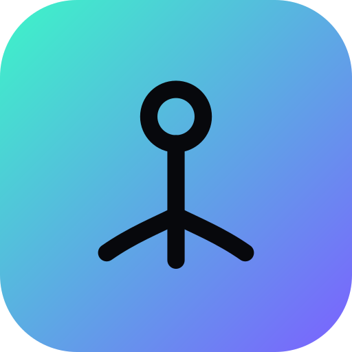

<h1 align="center">holdfast</h1>

## Every account. One root. Your server.

**Holdfast** is an open-source, self-hosted personal finance app: banks, cards, 401(k), HSA, brokerage and crypto in one place you run yourself.

- **Real US bank sync:** Plaid with your own keys, or SimpleFIN. Sync health you can actually see.
- **Your whole history:** statement PDFs reconciled to the penny, plus Mint, YNAB and Monarch importers.
- **Honest forecasts:** P10–P90 cash-flow bands that publish their own backtest error.
- **Private AI advisor:** Claude, a local Ollama model, or any compatible endpoint. Redacted, read-only, every call visible.
- **Self-custody:** your hardware wallet signs, and the server never sees your keys.

🌐 [holdfastfinance.app](https://holdfastfinance.app) · ✉️ hello@holdfastfinance.app · 🔒 security@holdfastfinance.app

*In development. AGPL-3.0. Not a bank. Not a CPA. Your software, your data.*
